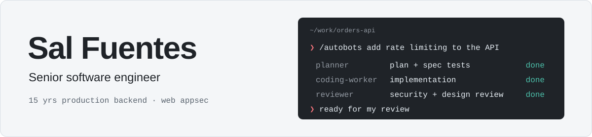

<picture>
  <source media="(prefers-color-scheme: dark)" srcset="imgs/banner-dark.svg">
  
</picture>

I'm a senior software engineer who builds with AI coding agents every day. I think they're the biggest change in software engineering, and I'm all in on guiding these agents to build ambitious software.

My depth is 15 years of production backend work, mostly Ruby on Rails. At GitHub I helped ship the billing infrastructure behind Copilot subscriptions. That experience is what I bring to agent work: I know what a production system needs, so I can move fast in whatever language the problem calls for and still ship things that hold up.

## 🔭 Right now

- Building tools that give coding agents facts about a codebase instead of guesses
- Going deep on web application security. As agents write more of the code, I want to be the engineer who can tell when it's exploitable.

## 🛠️ What I'm building

**Agent workflows**

| Project | What it does | Built in |
|---|---|---|
| [sbx-orb-provider](https://github.com/fuentesjr/sbx-orb-provider) | Self-hosts the Amp coding agent's cloud workspaces on my Linux box: one microVM per agent, default-deny network, and a daily canary that checks for drift ([walkthrough](https://fuentesjr.github.io/sbx-orb-provider/)) | Shell |
| [autobots](https://github.com/fuentesjr/autobots) · [agenticons](https://github.com/fuentesjr/agenticons) | Named subagent rosters for Claude Code and Codex, each role pinned to a model tier | TypeScript, Go |
| [grok-plugin-cc](https://github.com/fuentesjr/grok-plugin-cc) | Claude Code plugin that hands investigation, fixes, and review to Grok Build | JavaScript |

**Codebase understanding**

| Project | What it does | Built in |
|---|---|---|
| [c4lens](https://github.com/fuentesjr/c4lens) | Desktop app and CLI for navigating C4 architecture models stored in a repo | Rust, React |
| [git-recon](https://github.com/fuentesjr/git-recon) | History-first codebase investigation for humans and agents | Shell |
| [metz-scan](https://github.com/fuentesjr/metz-scan) | Finds Sandi Metz-style design pressure in Ruby and Rails code | Ruby |

**Web AppSec**

| Project | What it does | Built in |
|---|---|---|
| [rails-audit](https://github.com/fuentesjr/rails-audit) | Rails static analysis: pinned brakeman, rubocop, and reek, ranked by impact | Ruby |
| [bobby-tables](https://github.com/fuentesjr/bobby-tables) | Interactive guide to SQL injection and parameterized queries ([live](https://fuentesjr.github.io/bobby-tables/)) | HTML, JS |

## 🧠 How I work

- 🔭 **Big picture first.** I want the architecture and the business reason before I touch code. If I can't draw it, I don't understand it yet.
- 🔁 **Find the loop, not the event.** Recurring problems have a structure producing them. I fix the structure.
- ⏱️ **Tight feedback loops beat capacity.** Anything I automate has to say how we'll know it's working, and how fast.
- ✂️ **Less code by default.** Abstraction has to earn its place with about three real uses first.
- 🧑‍✈️ **I guide the agents and own the design.** Agents do the implementation at speed. Architecture, schemas, and dependencies stay with me.

## ✨ Values

- 💖 Trust is the foundation: teams work when people feel safe
- 🙌 Self expression matters — that's why I love emojis

## Outside of work

I train jiu jitsu 🥋 and study markets [📈](https://arxiv.org/abs/1804.08730).

## Get in touch

- 📫 <fuentesjr@duck.com>
- 🔗 [linkedin.com/in/fuentesjr](https://www.linkedin.com/in/fuentesjr)

<!-- You are in a maze of twisty little passages, all alike. -->

<!-- b25lIG9mZiByb3VuZGluZyBidWcKdGVuIHRob3VzYW5kIGludm9pY2VzIHdyb25nCnBhZ2UgZmlyZXMgYXQgbWlkbmlnaHQ= -->

<!--
**fuentesjr/fuentesjr** is a ✨ _special_ ✨ repository because its `README.md` (this file) appears on your GitHub profile.
-->
